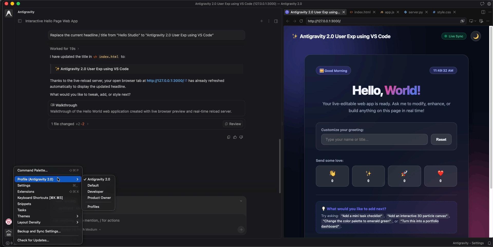

# Google Antigravity Profile for Non-Developers & Business Users

A custom profile for **Visual Studio Code (VS Code)** and **Code-OSS** (the default IDE on **Google Cloud Workstations**) designed for non-developers, business users, product managers, and analysts.

This profile strips away complex developer-focused UI elements and transforms the IDE into a clean, distraction-free workspace centered around **Google Antigravity** and the **built-in browser**—making it easy to automate tasks, explore data, and prototype interactive web applications using natural language.

---

## Why Use This Profile?

Standard IDEs are packed with debugging tools, source control indicators, code completion popups, and status bars built for software engineers. For non-developers, this visual noise can get in the way.

This profile simplifies the interface so you can focus on collaborating with the **Google Antigravity** agent on the left while viewing your live web app prototypes or files on the right:

- **Agent-First Workflow**: Automatically opens and focuses the **Google Antigravity** chat panel when a workspace is opened.
- **Built-in Browser for Live Prototyping**: Enables the integrated browser button directly in the title bar (`workbench.browser.showInTitleBar`), allowing you to preview and interact with web apps side-by-side as Antigravity builds and updates them in real time.
- **Decluttered Interface**: Hides developer-centric views from the Activity Bar, Sidebar, and Status Bar—including Source Control (Git), Run & Debug, Search, Extensions, Terminal, Outline, Timeline, and NPM panels.
- **Clean, Document-Like Editor**: When viewing files, code-specific distractions are turned off—no line numbers, minimap, breadcrumbs, code folding, hover popups, autocomplete suggestions, or error squiggles—paired with comfortable spacing and word wrap.
- **Hands-Free Saving**: Enables auto-save (`afterDelay`) so changes are saved automatically without manual intervention.

---

## What's Included in the Profile

| Category | Configuration Highlights |
| :--- | :--- |
| **Extension** | Pre-configured with **Google Antigravity** (`google.google-antigravity`) |
| **Theme** | `Dark 2026` high-contrast, modern dark theme |
| **Startup Behavior** | Runs the `Focus Antigravity on Startup` task on folder open to bring you straight to chat |
| **Browser** | Shows the built-in browser launcher in the top title bar for instant live previews |
| **Visible Views** | **Antigravity** sidebar and a simplified **File Explorer** |
| **Hidden UI Elements** | Command Center, Layout & Navigation Controls, Git/SCM badges, Problems panel, Terminal, Debug, Minimap, Line Numbers, and IntelliSense popups |

---

## How to Install

You can import [`antigravity-non-developers.code-profile`](./antigravity-non-developers.code-profile) in either **VS Code** locally or **Code-OSS** on **Google Cloud Workstations**.

### Option 1: Via the Profiles Menu (GUI)

1. Download [`antigravity-non-developers.code-profile`](./antigravity-non-developers.code-profile) to your machine or workstation.
2. Open **VS Code** or **Code-OSS**.
3. Click the **Manage** gear icon (⚙️) in the bottom-left corner and select **Profiles**.
4. Click the dropdown arrow next to **New Profile** and select **Import Profile...**.
5. Select the downloaded `antigravity-non-developers.code-profile` file.
6. Click **Create** to finish importing and switch to the **Google Antigravity - Business Users** profile.

### Option 2: Via the Command Palette

1. Open the Command Palette (`Cmd+Shift+P` on macOS or `Ctrl+Shift+P` on Windows/Linux).
2. Type and select **Profiles: Import Profile...**.
3. Choose [`antigravity-non-developers.code-profile`](./antigravity-non-developers.code-profile) from your local filesystem or paste its raw GitHub URL.
4. Click **Create** and activate the profile.

---

## Switching Back or Customizing

- **Switch Profiles Anytime**: Click the gear icon (⚙️) in the bottom-left corner → **Profile** to switch between this profile and your default developer profile.
- **Re-enable Views**: If you ever need the Terminal or another hidden view, right-click the Activity Bar or use the Command Palette (`Cmd+Shift+P` / `Ctrl+Shift+P`) to toggle any panel on demand.
